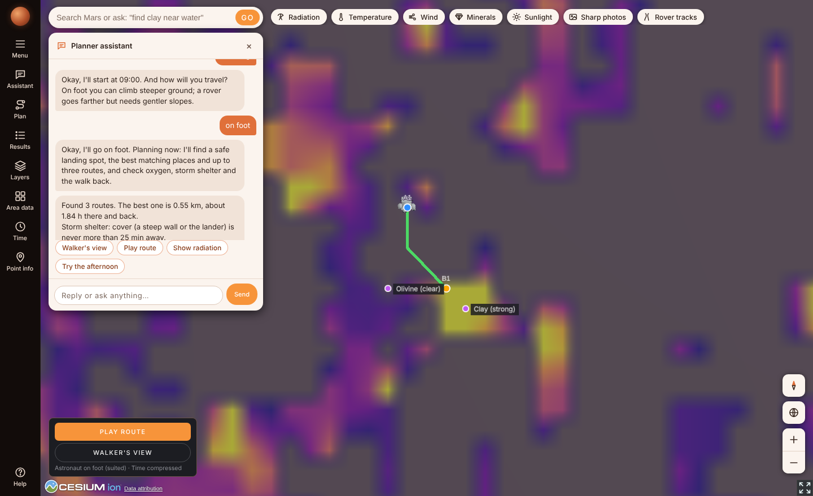

# Marswalk Planner — Python back end + Cesium front end

**NASA Space Apps Challenge 2026 · team MagiKid · Martian Map challenge.** Plan a safe Marswalk from real NASA data:
type a goal ("find clay where water once flowed"), answer the assistant's questions, and get up to three routes
checked for oxygen, storm shelter, radiation and the walk back, with eye-height views along the way.



**Try it in two minutes** (Python 3.10+ and internet for the NASA map tiles):
```bash
git clone https://github.com/siddhilakkarsu-max/NASAHackathon26Magikid && cd NASAHackathon26Magikid
./run.sh          # Windows: double-click run.bat. Then open http://localhost:8000
```
Type `I want to find clay` in the search bar, answer the two questions, then try `Walker's view`.
Data sources: [docs/SUBMISSION_REFERENCES.md](docs/SUBMISSION_REFERENCES.md) · AI use: [AI_DISCLOSURE.md](AI_DISCLOSURE.md).

Every pixel of Mars holds a vector of values (elevation, slope, roughness, ground firmness, …).
User inputs (time of day, season, vehicle, EVA budget) are applied per pixel to produce
a cost map, a safe route, a walk-back zone and a time-to-shelter map.

```
build_cube.py  ──►  cubes/<region>.npz  ──►  app.py (FastAPI, all the math)  ──►  frontend/index.html (Cesium globe)
```

## Quick start (one command)
Double-click `run.bat` on Windows, or run `./run.sh` on macOS/Linux. It finds Python 3.10+, creates `.venv`,
installs `requirements.txt` (again only when it changes), starts the server and opens http://localhost:8000.
Options: a port number (`run.bat 8001`), `--reload`, `--no-browser`, `--help`. The committed Jezero cube is used,
so no demo data is needed. To do the same by hand, follow steps 1 and 2.

## 1. Set up (once)
```bash
python -m venv .venv && source .venv/bin/activate      # Windows: .venv\Scripts\activate
pip install -r requirements.txt
```

## 2. Run it right away with demo data
```bash
python make_demo_cube.py          # only without cubes/jezero.npz: FAKE terrain, overwrites the real cube
uvicorn app:app --reload --port 8000
```
Open http://localhost:8000 → the globe starts on the global temperature layer. Use **Zoom to region** for Jezero. Open **Manual planning** to set a base and a target, then press **Plan route**.
The gear page is at http://localhost:8000/kit.html; **Gear for this route** under Manual planning opens it for the
planned route (see `gear/README.md`).

## 3. Swap in real NASA data

### Radiation map

Choose **Radiation · modeled GCR effective dose** in Map layer, or open
`http://localhost:8000/?layer=radiation_dose`. Hover for coordinates, the estimated
effective dose rate in **µSv/h**, atmospheric pressure, and seasonal dust context.
The existing local-hour and season controls change historical OpenMARS pressure.
Solar activity is a separate, explicit 400/700/1000 MV model scenario.

Purple indicates lower rates and green higher rates. **Show spatial differences**
uses fixed bounds for the selected solar scenario; **Compare solar scenarios**
uses a shared 12–30 µSv/h scale. The underlying values are identical in both views.
The native pressure grid is 5°; smooth rendering does not add measured detail.

This layer interpolates the published AtRIS surface effective-dose model, not
global NASA radiation observations or a current forecast. Dust is context only;
solar particle events and local shielding are excluded. Cells outside the source
pressure range (82–1200 Pa) stay N/A. See [method, numeric provenance and
limitations](radiation_data/README.md), also linked from the layer legend.

### Terrain and instrument maps

```bash
python build_cube.py jezero                   # overwrites the demo cube (~29 m/px as set in config.py)
python build_cube.py jezero --px-per-deg 512  # ~115 m/px: the committed cube (small enough for git)
python build_cube.py global                   # whole planet, ~3.7 km/px (slower)
```
`config.py` lists the sources for each band and tries them in order:
1. a **local GeoTIFF** you downloaded (most reliable — uncomment the `file` line and set the path)
2. a **remote GeoTIFF** (reads only the Jezero window)
3. the **USGS WMS** map server

If a download fails, the script says which band was skipped. Elevation is required; everything else is optional.
Check the result by opening `cubes/jezero.tif` in QGIS (each band is labeled).

Datasets in the Jezero cube (all fetched automatically by `build_cube.py`; downloads are cached in `data/`):

| Band(s) | Dataset | Resolution | Source |
|---|---|---|---|
| `elevation` → `slope`, `aspect`, `roughness` | CTX DEM of Jezero (Mars 2020 TRN, USGS); MOLA–HRSC blend elsewhere | 20 m (200 m) | planetarymaps.usgs.gov/mosaic/mars2020_trn |
| `imagery` | CTX orthomosaic of Jezero | 6 m | same |
| `thermal_inertia` → `firmness` | Calibrated THEMIS thermal inertia of Jezero; outside it Huang 2026 (1 km browse) | ~100 m / 1 km | zenodo.org/records/4931348, zenodo.org/records/23527756 |
| `minerals` → `science` | CRISM dominant-mineral class map of Jezero (0 = no data) | — | zenodo.org/records/5575824 |
| `albedo` | TES bolometric albedo (whole planet) | 7.4 km | planetarymaps.usgs.gov |
| `air_column_vs_gale` | radiation shielding: air column above vs Gale crater (Curiosity RAD ~0.64 mSv/day), from elevation | — | computed |
| `themis_night`, `themis_day` | THEMIS IR mosaics (USGS WMS) | 100 m | planetarymaps.usgs.gov |
| `clay`, `carbonate`, `olivine`, `pyroxene`, `sulfate`, `hydrated_silica`, `hydrated` | CRISM summary parameters (Viviano-Beck et al. 2014): 15 targeted observations (MTRDR) + the multispectral map tile (MRDR) | 18–180 m | PDS Geosciences via ode.rsl.wustl.edu |

- **Minerals:** each band holds the CRISM band depth for that mineral (e.g. `clay` = D2300). Parameters and
  detection thresholds are in `config.MINERALS`; add a mineral there and rebuild. Targeted observations are used
  where they exist, the 180 m map tile fills the rest; places CRISM never imaged stay empty.
- **Firmness** follows the thermal-inertia classes: <150 fine dust, 150–300 sand, 300–600 coarse/crusted,
  >600 bedrock (log scale, 150 → 0 ... 600 → 1), plus local THEMIS night-IR detail; night IR alone where TI is missing.
- **Mission suitability** layer = 0.45 × safety (slope + firmness) + 0.35 × science (CRISM detections)
  + 0.20 × radiation shielding (`suitability()` in `app.py`).
- **Sharp imagery (5 m)**: the Murray Lab black-and-white CTX mosaic (Caltech; Esri OnMars tiles) loads inside the
  selected region or any box you draw ("Box a sharp area"), above every background map. Clicking outside every
  cube does a live global lookup (`/api/point`).
- **Murray Lab maps** (panel section, all off by default): every map from the
  [Murray Lab CTX viewer](https://murray-lab.caltech.edu/CTX/V01/SceneView/MurrayLabCTXmosaic.html) -
  CTX 5 m mosaic, MOLA colour topography and Viking MDIM tiles (straight from Esri's OnMars services),
  **3D terrain** (MOLA/HRSC 200 m, relayed by `murray.py` so Cesium accepts it), the Mars 2020 and MSL traverses,
  IAU feature names, impact craters, the CTX tile map (click a point for its download page) and HiRISE footprints
  (only those in view; click a point to list the HiRISE images covering it). Downloads are cached in
  `cubes/murraycache/`. Caltech's server sends the wrong intermediate certificate, so the correct public one is in
  `certs/` and is trusted for those downloads only.
- Not included yet: TES dust cover index, GRS/MONS hydrogen, SHARAD/MARSIS ice, OMEGA (no ready GeoTIFF found).

## 4. Add a new band (TES dust, hydrogen, …)
Add an entry to `SOURCES` in `config.py`, rerun `build_cube.py`. It automatically appears in the
pixel panel. To use it in the route cost, edit `cost_seconds_per_meter()` in `physics.py`.

## 5. Plan a mission (main panel)
Type a goal (**sample clay where water once flowed**, **olivine**, **carbonate in a valley**), pick the vehicle
(on foot, 2-wheel, 4-wheel, pressurized buggy), season and priority (safety / speed / energy), press **Plan mission**.
`mission.py` then:
1. reads the goal into target features (keywords, else the AI model) and lists the **tools** (by goal + essentials,
   total kg and W);
2. scores every pixel for the goal, removes Special Regions, slopes beyond the vehicle and very loose ground
   (thermal inertia < 150) and anything out of range of a safe landing spot, and keeps the **top 3 destinations B**;
3. gives each B the closest safe **landing spot A** (flat <5°, few rocks, thermal inertia ≥200, below −500 m,
   within 50° of the equator, all over a 500 m circle): **NASA candidate** if it lies in a known landing site /
   ellipse (`config.NASA_SITES`), else **Tool-found**; plus a **detail card** (target and data confidence,
   terrain, conditions, nearby resources, sampling spots, protection status, distance from A);
4. routes A → B on a cost map built from time, energy/oxygen, terrain risk and seasonal dust; Perseverance's
   **green** drives cost ×0.7, **yellow** ×1.5, **red** (beyond the vehicle) is blocked; then checks the round
   trip's oxygen and/or battery with tool mass, a 15–25 % reserve and a turnaround deadline, dropping failures;
5. scores the survivors 1–5 in a **decision matrix** (`config.MATRIX_CRITERIA`; the priority adds +10 to
   safety, time or resources) and recommends the best;
6. shows the winner colored by risk, #2/#3 faded, and explains why: the summary from the numbers appears at once,
   then the AI model's reasoning streams into a "AI reasoning" box and its explanation streams in word by word.
   When the AI reads the goal, its thinking streams live too (kept under "How … read the goal"). Change vehicle/priority/season, tick "stick to green tracks" or click #2/#3 to adjust; the new
   plan is compared with the previous one.

**Hover over a route** (mission candidates, the manual route, or Perseverance's tracks): a 3D rover stands at that
point facing along the route, with a card showing distance and time so far, elevation, slope, ground type, risk,
sunlight, and oxygen/battery used so far, plus what would be left if you turned back there. The rover model
(`frontend/rover.glb`, 44 KB) is generated by `python tools/make_rover_glb.py`.

Rover tracks: `python fetch_tracks.py jezero` downloads Perseverance's real traverse (NASA/JPL mission maps).
All vehicle, suit, tool and landing numbers live in `config.py` (`MISSION_VEHICLES`, `SUIT`, `TOOLS`,
`LANDING_RULES`, `SEASONS`, `PRIORITIES`) and are first-order assumptions; tune them there.

### Planning anywhere on Mars
The region menu starts on **Anywhere on Mars (where you're looking)**: move the globe anywhere and press **Plan
mission**, **Find** or **Plan route**. If no loaded area covers the centre of the view (or the route's midpoint),
the server builds one, a 0.8° box (~47 km at the equator, ~115 m/px), in a few seconds:
- **elevation from the globe's own 3D terrain** (Esri MDEM200M, MOLA + HRSC 200 m, decoded from its LERC tiles), so
  routes are planned on the surface you see; checked at Jezero against the CTX 20 m model: median difference 0 m,
  typical difference 14 m, correlation 0.997;
- THEMIS night/day IR, TES albedo, and thermal inertia from the THEMIS tile of that Mars Chart quadrangle (35° S–45° N);
- **CRISM minerals** follow in the background (a few minutes); the panel says when mineral goals work there.
Loaded areas are kept (`cubes/site_<lat>_<lon>.npz`) and listed under *Loaded areas*. NASA landing sites and
science targets are matched by location, so Curiosity's landing site counts as a NASA candidate in any area around
Gale. Build one from the command line with `python build_cube.py site_-4.59_137.44` (or a name in `config.SITES`).

Landing rules split into ground rules (slope, roughness, firm ground, Special Regions), which always apply, and
lander rules (elevation below -500 m for a parachute, latitude within 50°). Where no spot in an area meets the
lander rules (the highlands, the poles), spots are chosen on the ground rules and the plan says so.

## 6. Find a target by description (manual planning)
Type e.g. **valley with clay**, **flat firm ground near a cliff**, **sunny ridge close to base** or
**shelter without sand** into "describe the target" and press Enter. `search.py` scores every pixel for
each word (valley, ridge, flat, steep, firm, sand, sunny, shadow, shelter, clay, …), combines them, sets the
best passable spot as the target and lists the runners-up. With a base set, places you can reach and return
from within the EVA budget rank first.
- New word? Add it to a feature's `words` in `search.FEATURES`.
- **Minerals:** clay, carbonate, olivine, pyroxene, sulfate, opal/hydrated silica, "water" (water-bearing
  minerals) and "minerals" (any detection) use the CRISM bands, matching only above the detection limit. A region
  without CRISM bands falls back to the approximate zones in `config.SEARCH_ZONES`.
- **Claude (recommended):** with `ANTHROPIC_API_KEY` set, every AI job (reading a goal, explaining the plan, writing
  the map labels) uses Claude through the Anthropic API (`claude_ai.py`, model `claude-haiku-5-5` by default;
  `CLAUDE_MODEL` and `CLAUDE_EFFORT`, default `medium`, change it). Claude's summarized thinking streams to the page,
  and a full mission takes ~15 s. Keep the key in the server's environment (e.g. an `ai.env` sourced before
  uvicorn), never in the repo. Without it, the OpenRouter / local-model options below are used.
- Words the built-in parser doesn't know go to a **free AI model on OpenRouter** if `OPENROUTER_API_KEY` is set
  (free key at openrouter.ai, `export OPENROUTER_API_KEY=...` before starting uvicorn). It picks the current
  `:free` models automatically, falling back from one to the next; set `OPENROUTER_MODELS=a:free,b:free` to choose.
  Free models are limited to 20 requests/min and 50/day per account (1000/day after buying $10 of credits);
  there is no unlimited $0 text model. Known-word queries ("valley with clay") never use the AI, and answers are
  cached. Without a key, the search runs on the known words and lists the rest.
- Offline or over the free limit? Any OpenAI-compatible server works, e.g. Ollama:
  `OPENROUTER_BASE_URL=http://<host>:11434/v1 OPENROUTER_API_KEY=local OPENROUTER_MODELS=gemma4:26b-a4b`.
  Tested on a laptop with a 4 GB T1200 GPU: `gemma4:26b-a4b` ~9 s per query, `gemma4:e4b` ~4 s.
- The mission panel streams the AI's thinking. `AI_REASONING` sets the thinking effort (`low` by default, `none` to
  turn it off); `AI_THINK_SECONDS` (default 15) stops a model that is still thinking after that long and asks for
  the answer right away. With the local gemma4:26b a full mission with AI takes ~2 min (thinking is visible
  throughout); give Ollama at least an 8k context (`OLLAMA_CONTEXT_LENGTH=8192`) so the thinking fits.

## Who owns what
| File / function | Owner | What to improve |
|---|---|---|
| `physics.py` → `slip_fraction`, `speed_kmh`, `cost_seconds_per_meter` | Victoria, Gia | Slip table, metabolic/O₂ cost, weights |
| `physics.py` → `sun_position`, `illumination`, `surface_temp_k` | Jason | Replace the approximate temperature with the thermal model |
| `physics.py` → `shelter_seeds`, walk-back in `app.py` | Gia, Siddhi | Real shelter locations, O₂ budget instead of hours |
| `config.py` → `SOURCES`, `SCIENCE_TARGETS`, `VEHICLES` | Siddhi, Darren | Real data paths, CRISM targets, vehicle limits |
| `physics.py` → `endurance`, `config.py` → `consumables`, `CONSUMABLE_SOURCES` | Gk | Real EVA and cabin O₂ loads, rover power curves |
| `app.py` → `explanation` text | Darren, Jason | Hook an LLM in here for richer route reasoning |
| `frontend/index.html` | Gia, Victoria, Olivia | All styling and layout |

## API (for the front end team)
| Call | Returns |
|---|---|
| `GET /api/regions` | regions, bounds, bands, vehicles, science targets, `vehicle_specs` (rated hours + consumable limits) |
| `GET /api/pixel?lat=&lon=&region=` | every value stored in that pixel + ground type + confidence |
| `POST /api/layer/{slope|firmness|cost|illumination|temperature|shelter|elevation}` | PNG overlay + bounds + legend |
| `POST /api/plan` | route (lat/lon list), stats (distance, time, slope, **O₂/energy vs capacity**, max range), warnings, explanation, walk-back zone PNG |
| `POST /api/find` | best target spots for a text description (`"query": "valley with clay"`), why each matched, match heatmap PNG |
| `GET /api/mission/options` | vehicles, seasons, priorities, decision-matrix criteria and default weights |
| `POST /api/mission` | `{"goal", "vehicle", "season", "priority", "green_only"}` → settings, tools, 3 candidates (A, B, card, route, resources, scores), dropped, decision matrix totals, template explanation, science + off-limits PNGs, `id` |
| `POST /api/mission/stream` | the same plan as server-sent events with the AI's thinking live: `status`, `ai` (`phase`: goal / explain, `kind`: reasoning / content, `text`), `result` (the full plan), `explanation`, `done` |
| `POST /api/mission/{id}/explain` | the AI-written explanation for that plan (slower; falls back to the template) |
| `GET /api/tracks?region=&vehicle=` | rover drive segments classed green / yellow, km of each, red off-limits PNG for the vehicle |
| `POST /api/sites/build` | `{"lat", "lon"}` (or `{"site": "gale"}`): load the area there (reuses a loaded one that covers it) → `region`, `status` (terrain / minerals / done / failed), `ready` |
| `GET /api/sites/build/{region}` | build progress: `status`, `ready`, seconds, CRISM observations done / total |
| `GET /api/sites` | named places in `config.SITES` and whether each is loaded |
| `GET /api/point?lat=&lon=` | live lookup anywhere on Mars (global elevation, slope, albedo, THEMIS), no cube needed |
| `GET /api/imagery/{region}` | hi-res photo overlay made by `build_cube.py <region> --imagery`, if present |
| `GET /ctxtiles/{z}/{y}/{x}.jpg` | 5 m CTX mosaic tile coloured with Viking colours (cached in `cubes/tilecache/`) |
| `POST /api/prefetch` / `GET /api/prefetch` | download every CTX tile in a box (levels 8–12) / progress |
| `GET /api/murray/layers` | the Murray Lab viewer's layers (tiles, terrain, GeoJSON, HiRISE) |
| `GET /murray/features/{m2020,msl,names,craters,quads}.geojson` | slimmed, cached feature layers |
| `GET /murray/hirise?west=&south=&east=&north=` · `GET /murray/hirise/at?lat=&lon=` | HiRISE footprints in a box / at a point |
| `GET /murray/quad/at?lat=&lon=` | the CTX mosaic tile at a point, with its download page |
| `GET /murray/elevation/` · `/murray/elevation/tile/{z}/{y}/{x}` | 3D terrain relay (MOLA/HRSC 200 m) for Cesium |

Body for POST calls: `{"region":"jezero","vehicle":"astronaut","local_hour":11,"ls":90,"budget_hours":4}`
(+ `"base":{"lat":..,"lon":..}, "target":{...}` for `/api/plan`).

## Consumables: O₂ and energy against what the traveller actually carries

Every plan is costed as a **round trip** over the planned route and compared with the vehicle's own capacity.
`stats` reports `o2_used_kg` / `o2_max_kg` / `o2_pct`, `energy_used_kwh` / `energy_max_kwh` / `energy_pct`,
`max_range_km`, and `limiting_factor` — whichever ceiling is closest to being hit.

| Traveller | Quantity | Rate | Carried | Basis |
|---|---|---|---|---|
| Astronaut on foot | O₂ | 0.114 kg/h on flat ground, adjusted for slope | 0.912 kg | NASA Mars suit design basis, see below |
| Pressurized crew rover | Energy | 1.5 kW idle + 0.12 kWh/km + climbing | 20 kWh | **estimate**, see below |
| Curiosity-class rover | Energy | 0.15 kW idle + 3.33 kWh/km + climbing | 2.5 kWh | MMRTG figures, see below |

**How the terrain is charged** (`consumables_block` in `app.py`, helpers in `physics.py`):

- **Walking, slope.** The return leg is the route walked in reverse, so every climb out is a descent back.
  Effort per metre follows Minetti et al. 2002 (*J Appl Physiol* 93:1039): uphill costs far more, gentle
  downhill a little less. Over a 15 % grade the round trip costs about 46 % more oxygen than flat ground.
  `slope_o2_factor` reports it; `elevation_gain_m` / `elevation_loss_m` give the climb.
- **Walking, ground.** Slow sand and rough rock still cost their extra time. `terrain_o2_factor` compares the
  route with walking the same distance on flat, firm ground.
- **Carried load.** Walking cost is per kilogram moved, so tools are charged in proportion to body + suit + load
  (`physics.load_factor`; suit 104 kg from NASA's Mars suit target, body 80 kg an assumption). The gear page
  applies the kit's hand-carried mass.
- **Vehicles, climbing.** The energy to lift the vehicle up each climb (m g h) is added, `climb_kwh`. A lower
  bound: motor losses add to it.
- **Reserve.** 15 % of every supply is held back, 20 % in the dust-storm season (Ls 180–330), from the team's
  resource research. `o2_usable_kg` / `energy_usable_kwh`, the range and the binding limit use what is left.
- **Dust and sunlight.** Dust opacity at the route comes from the team's weather data (`mars_weather`), turned
  into the share of a sol's direct sunlight that reaches a panel, as in the temperature model (`sunlight_pct`).
  Solar rovers report the sols of sunlight needed to recharge (`recharge_sols`); the crew rover uses the team's
  2:1 charge-to-drive ratio (`recharge_h`). Nuclear rovers are unaffected. Direct light only, so it is the
  pessimistic end.

**Where the numbers come from** (also returned per vehicle as `vehicle_specs[k].source`):

- **O₂, astronaut** — NASA's Mars suit design basis (SBIR topic EVA.2.S26B, 2026) sizes the oxygen supply for
  1.9 g/min averaged over 8 h: 0.114 kg/h and 0.912 kg. For comparison NASA's baseline document gives
  0.076 kg/h for current EVAs and the Apollo walk-back rate was 0.181 kg/h.
- **Endurance, astronaut** — 8 h, the same design basis; Artemis surface EVAs are planned at 4–8 h.
- **Energy, Curiosity-class** — MSL's MMRTG produces ~110 W electrical, 2.5–2.7 kWh per sol (NASA/JPL). Loads:
  at least 150 W whenever awake, up to 500 W while driving (JPL), which at this profile's 0.15 km/h works out
  at ~3.3 kWh/km. So a sol of MMRTG output is genuinely about 0.3 km out-and-back — the rover is meant to
  look limited next to the crew rover, not broken.
- **Energy, pressurized crew rover** — a **labelled engineering estimate**; no published NASA figure was found
  for these loads. It is the "estimate" entry in `CONSUMABLE_SOURCES` in `config.py` and should be tuned.

Rules the planner applies:

- `rated_hours` is a hard per-vehicle ceiling, separate from the EVA budget. The budget slider's maximum
  follows the selected vehicle, so you cannot plan past its rating.
- `reserve` still applies: only `budget_hours × (1 − reserve)` counts as usable time.
- `max_range_km` is the furthest one-way distance you can reach **and** return from, on a full load less the
  reserve, at the pace and terrain of the route you just planned.
- Routing itself is still time-based only. An over-capacity trip is drawn and flagged rather than refused —
  state-space pathfinding on remaining energy would be the next step, not something this pretends to do.

The gear page (`/kit.html`) costs the same route with the kit's hand-carried load. Its **Season (Ls)** input
(`?ls=250`) shows the dust-season reserve and sunlight; the `delta-walk` and `delta-dust` scenarios compare the
two seasons.

## Optional: Cesium Mars 3D terrain
The globe works without an account (NASA Mars Trek imagery). For 3D terrain, create a free
Cesium ion account, add **Cesium Mars** from the Asset Depot, and put your token and asset id
at the top of the `<script>` in `frontend/index.html`.

## Honest limits (say these if judges ask)
- Outside the calibrated Jezero map, thermal inertia is the 1 km browse map (absolute level uncertain by
  ~12–24 %); local firmness detail comes from the uncalibrated THEMIS night-IR picture.
- CRISM band depths show where a mineral's spectral signature is, not how much of it there is; the targeted
  observations (18 m) and the map tile (180 m) have different noise, so seams can appear at their edges.
- **Simulated surface temperature** uses TES broadband albedo and apparent thermal inertia. The overview uses 0.5° cells, with finer 0.125° TES inputs when zoomed in on the global layer. Unavailable thermal inertia is transparent.
- The model uses the selected Mars local solar hour and solar longitude (`Ls`) to compute diurnal solar heating. It approximates thermal emission and subsurface conduction, including heat retained after sunset. It uses spatially and seasonally varying OpenMARS visible column dust opacity. The calculation assumes level terrain, emissivity 0.95, and fixed downwelling longwave flux of 25 W/m². It has no seasonal frost model, and its absolute temperature has not been calibrated to Jezero observations.
- Primary grid sources are [NASA PDS TES albedo](https://pds-geosciences.wustl.edu/missions/mgs/tesspecial.html) and [NASA PDS TES apparent thermal inertia](https://pds-geosciences.wustl.edu/missions/mgs/tes-timap.html). The thermal grid uses observation-backed TES nighttime values where available, with observation-backed TES daytime values filling remaining supported cells.
- Areas loaded outside Jezero use the 200 m terrain (Jezero uses the CTX 20 m model), so slopes there are smoother
  than reality at the ~100 m scale. THEMIS stops near ±60° latitude: beyond it ground firmness is unknown (assumed
  medium, and the plan says so).
- Walk-back and consumables estimates assume the return trip costs the same as the way out.
- O₂ is modeled at a flat rate. Uphill terrain increases time and therefore oxygen use.
- The oxygen budget applies to the astronaut’s suit supply. The crew rover’s cabin oxygen is outside the model.
- Pressurized-rover loads are engineering estimates.
- Shelter denotes terrain near steep slopes. Confirm that a site can provide actual cover with higher-resolution imagery.
- At roughly 110 m per pixel, the regional slope map smooths out meter-scale hazards.
- Rover track colors are a proxy: green = Perseverance drove there; yellow = the rover recorded ≥12° tilt or the
  ground is steep/loose. JPL publishes no per-drive slip, and places rovers avoided aren't in the data; red is
  terrain beyond the chosen vehicle's limits. At Jezero most goals sit 8–20 km from the traverse, so routes rarely
  use it.
- The Mars 2020 landing ellipse is approximated as a 3.5 km circle around the actual landing site. No COSPAR
  Special Regions are known at Jezero, so that mask is empty there.
- Routes use Dijkstra (skimage MCP) on the cost grid: the same lowest-cost route A* finds, without its heuristic speed-up.
- Vehicle, suit, tool and energy numbers are first-order assumptions (see config.py).

## Weather layers and data

The **Global weather** group includes simulated ground temperature, an OpenMARS ground-temperature reference, near-surface air temperature, surface pressure, wind speed, animated wind arrows, and seasonal infrared dust opacity. Arrowheads follow the horizontal wind field, with motion sped up for display. The background shows speed and the animation can be paused. Hover for native-cell coordinates and values, or click to keep a reading in the panel. The **Overlay opacity** slider exposes the NASA Viking imagery underneath. The hour control applies the same local solar hour at each longitude. These layers represent historical or climatological scenarios.

**Weather timeline** accepts start and end sols (days within a Martian year), with a scrubber for individual sols. Playback skips frames on long ranges. The seasonal sol-to-`Ls` conversion comes from the LMD climatology file's daily coordinates.

The globe uses a bundled, downsampled [NASA/JPL Mars Trek Viking MDIM 2.1 mosaic](https://trek.nasa.gov/tiles/apidoc/trekAPI.html?body=mars) plus higher-resolution network tiles at closer zoom. CesiumJS 1.147.0 is bundled under its included Apache License. Global ground temperatures start with a 0.5° overview. When the view is close enough, the app computes only the visible region plus a small margin using 0.125° TES inputs (about 7.4 km north–south) and displays the range for that view. Missing thermal inertia is transparent at both scales. The OpenMARS atmosphere and ground-temperature reference stay at their 5° source resolution. Wind glyph density rises with zoom while following the same 5° wind field. Interface references include [NASA Worldview](https://worldview.earthdata.nasa.gov/), [NASA GIBS](https://nasa-gibs.github.io/gibs-api-docs/access-advanced-topics/), and [earth/nullschool](https://earth.nullschool.net/).

- **Air, pressure, wind and visible dust:** [Holmes, Lewis and Patel, OpenMARS](https://doi.org/10.21954/ou.rd.c.4278950), retrieved from [Bhattacharya's ARCO-OpenMARS conversion](https://doi.org/10.57967/hf/8741), CC BY 4.0. The app uses twelve approximately ten-sol windows from Mars Year 29, a 5° grid, and twelve two-hour samples per sol. Air temperature and winds are from the lowest available model level (sigma ≈ 0.9995). The app averages within each window, interpolates cyclically between windows and hours, and computes wind speed and direction from the interpolated components.
- **Displayed dust opacity:** [LMD climatology scenario](https://www-mars.lmd.jussieu.fr/mars/dust_scenarios/), derived from the [Montabone et al. dust climatology](https://www-mars.lmd.jussieu.fr/mars/dust_climatology/) (CC BY-SA 3.0). It is 9.3 μm absorption opacity normalized to 610 Pa, so its map depends on season alone. The ground model uses the OpenMARS visible-band field for sunlight attenuation.
- **Reference ground temperature:** The `tsurf` field from the same twelve OpenMARS Mars Year 29 windows provides an independently modeled ground-temperature comparison at 5°. The finer TES-driven simulation uses observed surface-property inputs and the same coarse dust forcing, and still assumes 25 W/m² of downwelling longwave radiation.
- `thermal_data/weather.npz` contains the processed grids for offline computation. To rebuild it with Internet access, install `blosc2` and `zstandard` in addition to the normal requirements and run `python build_weather.py`. The builder uses curl and downloads only the twelve required reanalysis windows.
- The app's **Weather data and source inventory** link provides the reviewed catalog. Its role column indicates which numerical archives and imagery were used and which sources are references or validation candidates.

### Independent check at Jezero

NASA PDS Mars 2020 MEDA Sol 30 derived TIRS data were evaluated in thirteen local true solar time windows around `Ls` 20.35°. Upward IR4 longwave flux was converted to brightness temperature with the instrument team's convention, `T = (flux / σ)^(1/4)`. The TES-driven model's kinetic temperature was converted to emitted brightness using its assumed emissivity of 0.95. Against these windows the mean absolute differences were 16.57 K at 0.5° and 16.92 K at 0.125°. The OpenMARS reference had a 4.45 K mean absolute difference in this check. That comparison uses a different weather year (MY29 versus MY36) and compares its modeled surface temperature with IR4 brightness. Rover spot-scale readings and modeled grid cells also represent different areas. The Jezero check is a local diagnostic and does not establish global accuracy. [NASA PDS MEDA archive](https://pds-atmospheres.nmsu.edu/data_and_services/atmospheres_data/PERSEVERANCE/meda.html) · [Instrument-team flux method](https://doi.org/10.1029/2022JE007537)

## HiRISE / CTX close-ups of Jezero (official Mars 2020 landing products, USGS)
Two map levels are set up in `config.py`:
- `jezero` – whole crater at ~29 m/px from the **CTX 20 m elevation** + **CTX 6 m image** (downloaded automatically)
- `jezero_hirise` – landing site + delta at ~9 m/px from the **HiRISE 1 m elevation** (1.8 GB, download first).
  Its cube is 100+ MB, so it is not in git (`.gitignore`): build it locally.

```bash
mkdir -p data && cd data
curl -O https://planetarymaps.usgs.gov/mosaic/mars2020_trn/CTX/ScienceInvestigationMaps_JPL/M20_JezeroCrater_CTXDEM_20m.tif
curl -O https://planetarymaps.usgs.gov/mosaic/mars2020_trn/CTX/JEZ_ctx_B_soc_008_orthoMosaic_6m_Eqc_latTs0_lon0.tif
curl -O https://planetarymaps.usgs.gov/mosaic/mars2020_trn/HiRISE/JEZ_hirise_soc_006_DTM_MOLAtopography_DeltaGeoid_1m_Eqc_latTs0_lon0_blend40.tif
cd ..
python build_cube.py jezero --px-per-deg 512   # the committed cube
python build_cube.py jezero_hirise               # high-res topography (6144 px/deg)
```
The Zenodo thermal-inertia and mineral files are downloaded automatically.
The 25 cm HiRISE image mosaic (~7 GB) is not used: too large for the weekend.
